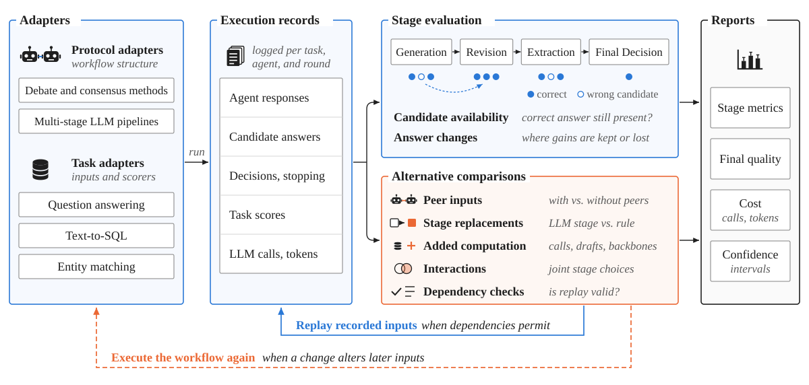
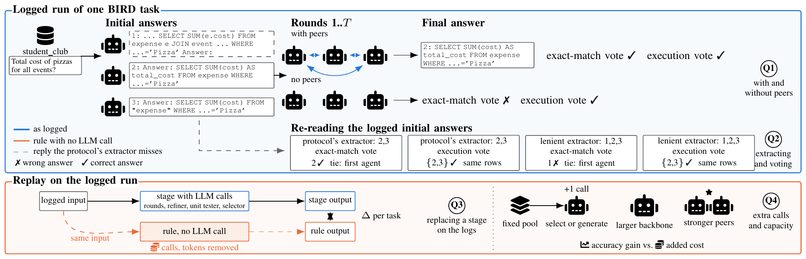

# SHARE-Eval: A Stage-Level Benchmarking Framework for Multi-Agent Debate and Consensus in Data Workflows

Reproducibility repository of the ICDE 2027 Experiment, Analysis, and Benchmark paper *SHARE-Eval: A Stage-Level Benchmarking Framework for Multi-Agent Debate and Consensus in Data Workflows*.

$\color{red}{\textbf{The supplement is}}$ [**paper/supplementary.pdf**](paper/supplementary.pdf)

SHARE-Eval benchmarks multi-agent debate and consensus workflows stage by stage. It compares alternatives
for a stage on the same inputs, measures their quality effects and their calls and tokens, and estimates
peer interaction effects under fixed extraction and voting rules. For each stage it measures how often the output
changes and whether the change improves accuracy; dependency checks establish when a comparison on
recorded inputs reproduces deployment. The paper evaluates five consensus protocols and three published
pipelines on question answering, text-to-SQL and entity matching.

## Benchmarking suite

<p align="center">
  
</p>

*Collection and evaluation workflow. Recorded-run comparisons use dependency checks to determine when replay can reproduce workflow execution.*

The logged runs are processed by the scripts in `share_eval/`, which write the scored tables the paper
objects read (see "SHARE-Eval on the logged runs" below). `share_eval_suite/` is a refactor of
`share_eval/` for reuse by others: it follows this figure module by module, so that another workflow, task
or stage alternative is added at the matching module and evaluated with the shared records, estimators and
reports. Its modules are `adapters/` (protocol and task adapters), `records/` (the execution record and
its readers), `stages/` (candidate availability, answer changes, grouping after entity matching),
`comparisons/` (peer inputs, stage replacements, added computation, interactions, dependency checks),
`reports/` (stage metrics, final quality, cost, confidence intervals) and `steps/`, which runs each
`share_eval/` analysis on the logged runs. A new protocol or task is added as an entry of the adapter
registries (`adapters/protocols.py`, `adapters/tasks.py`), and a new alternative for a stage as a
comparison in `comparisons/` that uses the estimators of `stats.py` and the reports of `reports/`.
Its results are the same as those of `share_eval/` (see "Same results as `share_eval/`" below).

## SHARE-Eval at a glance



*SHARE-Eval on one BIRD task: the logged run and its re-readings (top); a stage replaced on the logs (bottom).*

- **Logged run, with and without peers (Q1):** the protocol adapters and collection drivers in
  `code/consensus_delivery/` and `experiments/02_controlled_sharing/code/` log every call; the no-peer
  runs for Du-MAD and BCCS come from `experiments/14_nopeer_collection/`.
- **Where quality is lost (Q2):** `share_eval/replay/` re-reads each run under the protocol's extractor
  or the lenient extractor and under the exact-match vote or the execution vote, and follows correct
  candidates from the initial answers to the final answer; the answer-only peer runs come from
  `experiments/16_answer_only_peers/`.
- **Replacing a stage on the logs (Q3):** `share_eval/stage_replacement/` compares a stage with a rule
  that makes no LLM call on the same input, and charges the stage's calls and tokens; the pipelines'
  runs are in `experiments/10_chess_unit_tester/` and `experiments/11_macsql_comem_stages/`.
- **When a replay equals deployment (Lemma 1):** `share_eval/replay_validity/`.
- **Extra calls and capacity (Q4):** selection and generation on a fixed pool
  (`experiments/04_sql_selection_generation/`, `experiments/12_deepseek_selection_generation/`), larger
  backbones and other model families (`experiments/13_backbone_scale_cross_family/`,
  `experiments/08_cross_family/`), stronger peers (`experiments/15_stronger_peers/`), and debates
  against independent drafts at matched call budgets (`experiments/17_budget_matched_debates/`).

## What this repository reproduces

Every table, figure and printed number of the paper and its supplement that comes from a measurement.
Each is computed from scored per-question, per-run or per-pair tables by a short script and checked
against the number printed in the paper:

- 29 paper objects in `paper_objects/`, one directory per table, figure or group of prose numbers;
- 3,143 printed values and 101 statements (an interval excludes 0 or not, a count is zero), each
  matched to the sentence or table cell that prints it.

Each directory holds `inputs/` (per-question, per-run or per-pair scored tables), `code/compute.py`, the
expected `output/` and `object.json`, which lists each printed value with where the paper prints it
(`label`, `where`, and `tex_file`, the manuscript section file) and the output key that reproduces it.
A printed value passes when the computed value rounds to it; a value the paper states as a bound ("no
more than 2 pp") passes when the computed value does not exceed it. Values printed inside a figure are
checked against the plotted values. The paper map below lists every table and figure label of the paper
and the supplement with its directory.

## Running the check

```
python3 verify.py --recompute
```

This reruns every paper object's computation from its `inputs/`, compares each result with the shipped
`output/values.json`, and checks each printed value recorded in `object.json` (about one minute on a
laptop). Without `--recompute` it compares the shipped outputs only. The last line reads
`N of N checks passed; 3143 of 3143 printed values reproduce`; `--json FILE` writes every check and every
printed value with its computed value to FILE. No step calls a language model, starts an inference server,
opens a database or needs a GPU.

One object at a time, and a figure from its object's `output/`:

```
cd paper_objects/<dir> && python3 code/compute.py --out output
python3 paper_objects/check_objects.py --recompute --only <dir>
cd paper_objects/<fig_dir> && python3 code/plot.py
```

Figure binaries carry the plotting library's metadata and are not byte-identical across library
versions; the plotted values are.

## Paper map

Reading used by every BIRD debate object, as in the paper: lenient extractor and execution vote with ties
to the first agent unless a tie rule is stated; 198 sampled BIRD development questions or 1,531 BIRD
development questions; 95% paired bootstrap intervals over questions and over the 11 BIRD databases; an
effect is detected when both question-level and database-cluster 95% intervals exclude 0. The no-peer
runs of every object are those in its `inputs/`; their prompts contain no peer content.

### Main paper

| # | Label | Section | Directory | Printed values checked |
|---|---|---|---|---|
| Tab. I | `tab:design-dimensions` | II-B | — | design facts of the five protocols as run; no measured value |
| Fig. 1 | `fig:framework` | III | — | worked example; no measured value |
| — | `eq:candidate-flow` (Eq. 3) | III-C | `tab_candidate-flow` | statements: the identity holds exactly in every configuration and every run satisfies its ordering |
| — | `sec:evaluation-checks` | IV | `tab_s-reader-sensitivity`, `tab_s-online` | answer-recovery audits; online minus replay accuracy |
| Tab. II | `tab:matrix` | IV | `tab_matrix` | 11 (with the BIRD populations of Section IV); its trace and pair counts are checked in `text_matching-content` |
| Fig. 3 | `fig:access-matrix` | V-A | `fig_access-matrix` | 97 (figure cells, Section V-A, Supplement S5, S5-A, row R23 of Tab. S1) |
| Tab. III | `tab:family-sharing` | V-B | `tab_family-sharing` | 93 and 3 statements (with Tab. S6, S7) |
| — | `sec:matching-content` | V-C | `text_matching-content` | 196 (with Section VI-E, Tab. S8, S9, S23) |
| — | `sec:peer-source` | V-C | `text_peer-source` | 144 and 1 statement (with Tab. S10–S12) |
| — | `sec:candidate-flow` | VI-A | `tab_candidate-flow` | 71 and 13 statements (with Tab. S13 and Section S6-C) |
| Tab. IV | `tab:factorial` | VI-B | `tab_factorial` | 200 and 4 statements (with the debate row of Tab. VII, Section VII-A, Tab. S1, S20, Sections S2-B, S4-A) |
| Fig. 4 | `fig:readout-cells` | VI-B | `fig_readout-cells` | 126 plotted values |
| Tab. V | `tab:peer-controls` | VI-C | `tab_peer-controls` | 120 and 25 statements (with the peer-interaction paragraph of VI-B, the per-agent paragraph of VI-D, Tab. S14, S16, Section S4-A) |
| Tab. VI | `tab:answer-content` | VI-D | `tab_answer-content` | 53 and 7 statements (with Tab. S15, Section S6-B) |
| Fig. 5 | `fig:merge-validation` | VI-F | `fig_merge-validation` | 135 and 8 statements (with the abstract, Tab. S21, S22, Section S6-H) |
| Fig. 6 | `fig:stage-act` | VII-A | `fig_stage-act` | 89 (with Tab. S24) |
| Tab. VII | `tab:replacement-cost` (pipeline rows) | VII-A | `tab_replacement-cost` | 170 (with Tab. S25, S26, S28, Sections S7-B, S7-D); the debate row is in `tab_factorial` |
| Tab. VIII | `tab:sql-rule-strength` | VII-B | `tab_sql-rule-strength` | 228 (with Tab. S27, S29, S30) |
| — | `sec:grouping-rules` | VII-C | `text_grouping-rules` | 51 (with Section S7-E) |
| — | `sec:qa-vote-replay` (QA) | VII-D | `text_qa-vote-replay` | 9 (with Section S7-F) |
| — | `sec:qa-vote-replay` (matching) | VII-D | `text_matching-return-rule` | 10 (with row R20 of Tab. S1) |
| Fig. 7 | `fig:sql-family` | VIII-A | `fig_sql-family` | 59 (with Tab. S33) |
| Tab. IX | `tab:strength` | VIII-A | `tab_strength` | 272 (with Section VIII-C, Tab. S5, S32, S34–S38) |
| — | `sec:pool-availability` | VIII-B | `tab_s-pool-strata` | 41 and 7 statements (with Tab. S39) |
| Tab. X | `tab:scale` | VIII-D | `tab_scale` | 73 (with Tab. S40) |
| — | `sec:scale` (other model families) | VIII-D | `tab_s-cross-family` | 104 and 3 statements (with Tab. S41) |
| Fig. 8 | `fig:debate-budget` | VIII-E | `fig_debate-budget` | 173 and 22 statements (with Tab. S43–S45, Section S8-D) |
| Tab. XI | `tab:prior-evaluations` | IX | — | positioning against cited work; no measured value |

### Supplement

| # | Label | Directory |
|---|---|---|
| Tab. S1 | `tab:s-contrasts` | `tab_factorial` (class counts and rows R1, R3–R11); row R20 in `text_matching-return-rule`; row R23 in `fig_access-matrix` |
| Tab. S2 | `tab:s-suite-records` | execution information used by the suite; no measured value |
| Tab. S3 | `tab:s-coverage` | experiment matrix, as Tab. II |
| Tab. S4 | `tab:s-deviations` | configurations as run; no measured value |
| Tab. S5 | `tab:s-selector-controls` | `tab_strength` |
| Tab. S6 | `tab:s-first-decode` | `tab_family-sharing` |
| Tab. S7 | `tab:s-qa-transitions` | `tab_family-sharing` |
| Tab. S8 | `tab:s-confusion` | `text_matching-content` |
| Tab. S9 | `tab:s-content-choice` | `text_matching-content` |
| Tab. S10 | `tab:s-peer-effects` | `text_peer-source` |
| Tab. S11 | `tab:s-peer-change` | `text_peer-source` |
| Tab. S12 | `tab:s-weaker` | `text_peer-source` |
| Tab. S13 | `tab:s-candidate-flow` | `tab_candidate-flow` |
| Tab. S14 | `tab:s-peer-transitions` | `tab_peer-controls` |
| Tab. S15 | `tab:s-answer-transitions` | `tab_answer-content` |
| Tab. S16 | `tab:s-ties-expanded` | `tab_peer-controls` |
| Tab. S17 | `tab:s-controls` | `tab_s-controls` (239 values, with the controls of Section VI-C) |
| Tab. S18 | `tab:s-reader-sensitivity` | `tab_s-reader-sensitivity` (254 values, with the extractor audits of Sections S2 and S2-D) |
| Tab. S19 | `tab:s-failures` | `tab_s-failures` (35 values) |
| Tab. S20 | `tab:s-levels` | `tab_factorial` |
| Tab. S21 | `tab:s-reversals` | `fig_merge-validation` |
| Tab. S22 | `tab:s-relations` | `fig_merge-validation` |
| Tab. S23 | `tab:s-traces` | `text_matching-content` |
| Tab. S24 | `tab:s-decomposition` | `fig_stage-act` |
| Tab. S25 | `tab:s-chess` | `tab_replacement-cost` |
| Tab. S26 | `tab:s-chess-resources` | `tab_replacement-cost` |
| Tab. S27 | `tab:s-q25-rules` | `tab_sql-rule-strength` |
| Tab. S28 | `tab:s-exec-cost` | `tab_replacement-cost` |
| Tab. S29 | `tab:s-empty` | `tab_sql-rule-strength` |
| Tab. S30 | `tab:s-testsuite` | `tab_sql-rule-strength` |
| Tab. S31 | `tab:sensitivity-census` | `tab_sensitivity-census` (37 values, with Section S7-G) |
| Tab. S32 | `tab:s-did` | `tab_strength` |
| Tab. S33 | `tab:s-family-sql` | `fig_sql-family` |
| Tab. S34 | `tab:s-aligned` | `tab_strength` |
| Tab. S35 | `tab:s-repeat` | `tab_strength` |
| Tab. S36 | `tab:s-repeat-within` | `tab_strength` |
| Tab. S37 | `tab:s-availability` | `tab_strength` |
| Tab. S38 | `tab:s-quality-cost` | `tab_strength` |
| Tab. S39 | `tab:s-pool-strata` | `tab_s-pool-strata` |
| Tab. S40 | `tab:s-scale-contrasts` | `tab_scale` |
| Tab. S41 | `tab:s-cross-family` | `tab_s-cross-family` |
| Tab. S42 | `tab:s-online` | `tab_s-online` (41 values and 3 statements, with Sections S2-C and S8-C) |
| Tab. S43 | `tab:s-budget-cost` | `fig_debate-budget` |
| Tab. S44 | `tab:s-budget-contrasts` | `fig_debate-budget` |
| Tab. S45 | `tab:s-draft-diversity` | `fig_debate-budget` |

Supplementary text without a table: the proof of Lemma 1 (`sec:s-lemma-proof`) carries no measured value;
`sec:s-ford` is in `fig_access-matrix`; `sec:s-spend-peers` in `text_peer-source`; `sec:s-grouping-menu`
in `text_grouping-rules`; `sec:s-return` in `text_qa-vote-replay`; the availability paragraph of
`sec:s-spend-pool` in `text_generation-beyond-pool` (12 values and 4 statements); the replay counts of
`sec:s-inference` in `tab_factorial` and `tab_peer-controls`.

Rows R1, R3–R11, R20 and R23 of Tab. S1 are checked in the objects named above; the other rows restate
effects that the objects of their own sections check.

### Collection code behind each paper object

| Experiment code | Paper objects it feeds |
|---|---|
| `code/consensus_delivery/`, `experiments/02_controlled_sharing/` | `fig_access-matrix`, `tab_family-sharing`, `tab_candidate-flow`, `tab_factorial`, `tab_matrix`, `tab_peer-controls`, `fig_readout-cells`, `tab_s-controls`, `tab_s-reader-sensitivity`, `tab_s-failures`, `text_qa-vote-replay`, `text_matching-return-rule`, `tab_sensitivity-census`, `fig_debate-budget` |
| `experiments/14_nopeer_collection/` (no-peer runs of Du-MAD and BCCS) | `fig_access-matrix`, `fig_readout-cells`, `tab_factorial`, `tab_matrix`, `tab_peer-controls`, `tab_s-controls`, `tab_s-reader-sensitivity`, `tab_s-online`, `tab_scale`, `tab_s-cross-family`, `tab_sensitivity-census`, `text_matching-return-rule` |
| `experiments/04_sql_selection_generation/` | `tab_sql-rule-strength`, `tab_strength`, `fig_sql-family`, `tab_s-pool-strata` |
| `experiments/05_matching_downstream/`, `experiments/06_cost_resources/` | `fig_merge-validation`, `fig_sql-family` |
| `experiments/07_content_choice/` | `text_matching-content` |
| `experiments/08_cross_family/` | `tab_family-sharing`, `text_matching-content`, `fig_sql-family`, `text_peer-source`, `tab_strength`, `tab_replacement-cost` |
| `experiments/09_grouping_transfer/` | `text_grouping-rules`, `fig_merge-validation` |
| `experiments/10_chess_unit_tester/` | `fig_stage-act`, `tab_replacement-cost` |
| `experiments/11_macsql_comem_stages/` | `fig_stage-act`, `tab_replacement-cost` |
| `experiments/12_deepseek_selection_generation/` | `tab_strength`, `text_generation-beyond-pool`, `tab_s-pool-strata`, `tab_replacement-cost` |
| `experiments/13_backbone_scale_cross_family/` | `tab_scale`, `tab_s-cross-family`, `tab_s-online` |
| `experiments/15_stronger_peers/` | `text_peer-source`, `tab_strength` |
| `experiments/16_answer_only_peers/` | `tab_answer-content`, `fig_debate-budget` (the three-agent, two-round debates) |
| `experiments/17_budget_matched_debates/` | `fig_debate-budget` |
| `share_eval/replay/`, `share_eval/replay_validity/`, `share_eval/stage_replacement/` | the re-reading, Lemma 1 and stage-replacement steps behind the objects above |

### Figures

Figures 4–7 are drawn by the `code/plot.py` of the corresponding object from its `output/` (matplotlib);
Fig. 3 is a LaTeX table that `code/plot.py` writes from `output/`; Fig. 8 is drawn in LaTeX from the
plotted values its object checks:

| Figure | File | Generator |
|---|---|---|
| Fig. 3 | `access_matrix.tex` | `paper_objects/fig_access-matrix/code/plot.py` |
| Fig. 4 | `readout_cells.pdf` | `paper_objects/fig_readout-cells/code/plot.py` |
| Fig. 5 | `merge_validation.pdf` | `paper_objects/fig_merge-validation/code/plot.py` |
| Fig. 6 | `stage_act.pdf` | `paper_objects/fig_stage-act/code/plot.py` |
| Fig. 7 | `sql_family.pdf` | `paper_objects/fig_sql-family/code/plot.py` |
| Fig. 8 | drawn in the paper's source | plotted values in `paper_objects/fig_debate-budget/output/plotted_values.csv` |

### SQL execution

No paper-object computation executes SQL; the scored tables in `inputs/` carry execution outcomes. The
per-question scores of Qwen2.5-7B generation with and without execution feedback (`fig_sql-family`) were
obtained by executing the generated and reference queries read-only against the BIRD development databases
(4,393 statements). The Spider test-suite outcomes in `tab_sql-rule-strength` come from the stored
execution results on the test-suite databases.

## Layout

| Path | Contents |
|---|---|
| `paper/supplementary.pdf` | the supplement |
| `paper_objects/<dir>/` | `inputs/` (scored tables), `code/compute.py` (writes `values.json`), `code/plot.py` (figures only, draws the paper's figure from `output/`), `output/` (expected output), `object.json` (every printed value checked: where the paper prints it, printed form, output key) |
| `paper_objects/check_objects.py` | compares computed values with the printed ones |
| `verify.py` | runs all objects and the repository checks |
| `share_eval/` | the SHARE-Eval scripts for logged runs: re-reading and replay of logged debates (`replay/`), the Lemma 1 checks (`replay_validity/`), and stage replacement with calls and tokens (`stage_replacement/`) |
| `share_eval_suite/` | refactor of `share_eval/` as a Python package organised like the suite figure: adapters, execution records, stage evaluation, alternative comparisons, reports, and the `share_eval/` steps on the logged runs (`steps/`); tests check that its outputs equal those of `share_eval/` and reproduce the paper's numbers |
| `code/consensus_delivery/` | protocol adapters for Du-MAD, MAD-M², BCCS, MoA and FORD, the OpenAI-compatible client, answer extraction and scorers |
| `experiments/<NN_name>/` | collection and run code per experiment: 02 controlled sharing, 04 SQL selection and generation, 05 matching groups, 06 cost accounting, 07 and 08 peer content and model families, 09 grouping rules, 10 CHESS Unit Tester, 11 MAC-SQL Refiner and ComEM selector, 12 DeepSeek-V4-Pro selection and generation, 13 larger and cross-family backbones, 14 no-peer runs of Du-MAD and BCCS, 15 stronger peers, 16 answer-only peers (Du-MAD and MAD-M² on the 198 BIRD questions with full peer responses, extracted queries only, or no peers), 17 debate budgets and independent drafts (Du-MAD and MAD-M² at 3×2, 3×3, 5×2 and 3×4 agents × rounds, 20 independent initial drafts per question); `common/` holds modules they share |
| `docs/` | the suite figure and the overview figure |
| `data/external/` | checksums of the BIRD and Spider databases |

## Requirements

Python 3.12 or newer with `numpy`, `pandas` and `scipy` (`requirements.txt`); the figure scripts also
need `matplotlib`, and the tests of `share_eval_suite/` need `pytest`. The values were computed with CPython 3.14.5, numpy 2.4.6, pandas 3.0.3 and scipy
1.17.1. Every bootstrap seeds its own generator, so a recomputation returns the same `values.json`.

```
python3 -m venv .venv && . .venv/bin/activate && pip install -r requirements.txt
```

## Reading the numbers

- Terms are those of the paper: initial answers, last-round accuracy, the interaction effect (the
  accuracy change from the initial answers to the last round with peers, minus the same change without
  peers), placebo peers, the answer extractor, the exact-match vote and the execution vote.
- Effects are paired differences in percentage points (pp). For the BIRD debates an effect is detected
  when both question-level and database-cluster 95% intervals exclude 0. Holm corrections apply within
  the families the paper states.
- QA accuracy, SQL execution accuracy, candidate-pair F1 and pairwise cluster F1 are reported separately
  and never pooled.
- The no-peer condition removes the peer replies and the clauses that refer to them from every prompt
  and keeps rounds, stopping and return rules; `experiments/02_controlled_sharing/code/arm_transform.py`
  builds these prompts.

## SHARE-Eval on the logged runs

`share_eval/` holds the paper's evaluation procedure for logged multi-agent runs (Section III) in three
parts:

| Directory | What it does | Paper |
|---|---|---|
| `replay/` | re-reads logged debates under every combination of answer extractor (protocol's own or lenient), vote (exact-match vote or execution vote), round (initial answers or last round) and peer condition (with or without peers) | Sections III-C, VI-B; Table IV, Fig. 4 |
| `replay_validity/` | checks when a replay on the logs equals deployment (Lemma 1): first divergence of BCCS's own reads, bounds, the grouping bound, the online check, the sensitivity census | Sections III-D, VIII-D, S7-G; Table S31 |
| `stage_replacement/` | Eq. (4): for an extra stage replaced by a rule with no LLM call, how often the stage changes the result, its gain when it does, and its calls, tokens and GPU-seconds | Section VII-A; Fig. 6, Table VII |

All scripts run from the repository root with `python3 -I`, make no model call, and open the BIRD and
Spider databases read-only only when a query has no cached execution result. Seeds and bootstrap draws
are fixed in the code (10,000 draws; seed 20261106 for `replay/` and `replay_validity/`, 20261105 for
`stage_replacement/`). Every input and output path is also a command-line argument (`--help` lists
them); outputs go to `output/share_eval/<part>/` by default.

Inputs, from the hosted data (see "Data not in this repository"):

| Default path | Contents |
|---|---|
| `data/records/bird_debates/` | the BIRD debates among Llama-3-8B or Qwen2.5-7B agents (Du-MAD, MAD-M², BCCS, MoA; with and without peers; two repeats): `raw/sql_bird_v2__*.jsonl`, the evaluated set `analysis/sql_per_unit.jsonl` and the stored verdicts `analysis/sql_verdicts.json` |
| `data/records/bird_debates_backbones/` | the same layout for the larger Qwen2.5 and cross-family backbones and the online BCCS runs with execution voting |
| `data/caches/sql_execution/` | the execution result signature and verdict of every logged query; with them no query is executed |
| `data/records/dataeng_raw/sql/dev_20240627/dev.json` | BIRD development questions and reference queries; `ARTIFACT_ROOT` sets the directory that holds `data/records/` for the shared SQL helpers |
| `data/records/macsql_comem_stages/` | MAC-SQL and ComEM runs (`output/`, `data/llm4em/`, `raw/`, `logs/host/db_before.sha256`) |
| `data/records/chess_unit_tester/` | CHESS runs (`output/`, `data/tasks_147.json`, `raw/`, `logs/db_formal_after.sha256`) |
| `$BIRD_DB_DIR`, `$SPIDER_DB_DIR` | the BIRD and Spider databases (see "BIRD and Spider databases") |

```
python3 -I share_eval/replay/factorial_replay.py          # per_run_scores.jsonl, factorial_replay.json/.csv, ties.csv
python3 -I share_eval/replay/db_cluster_bootstrap.py      # database-cluster intervals
python3 -I share_eval/replay/report_tables.py             # tables.md
python3 -I share_eval/replay_validity/bccs_divergence.py  # bccs_divergence_runs.jsonl, bccs_divergence.json
python3 -I share_eval/replay_validity/bounds.py           # bounds.json (bounds_bccs_only.py for BCCS without replay scores)
python3 -I share_eval/replay_validity/grouping_bound.py   # grouping_bound.json
python3 -I share_eval/replay_validity/online_validation.py
python3 -I share_eval/replay_validity/sensitivity_census.py
python3 -I share_eval/stage_replacement/reexec.py         # unit files of fig_stage-act and tab_replacement-cost
python3 -I share_eval/stage_replacement/throughput.py     # throughput and GPU-seconds per stage
python3 -I share_eval/stage_replacement/decompose.py      # Eq. (4) per stage and rule
python3 -I share_eval/stage_replacement/costs_comparable.py
python3 -I share_eval/check_consistency.py                # steps whose inputs ship with the repository
```

`per_run_scores.jsonl` is the input of `paper_objects/tab_factorial`, `fig_readout-cells`, `tab_matrix`
and `tab_s-controls` and of `replay_validity/`; `bccs_divergence_runs.jsonl` of `tab_factorial` and
`tab_s-online`; the unit files of `reexec.py` of `fig_stage-act` and `tab_replacement-cost`. With the
logged runs in place, these scripts reproduce the shipped inputs byte for byte.

### `share_eval_suite`

```
python3 -m share_eval_suite list-protocols [--kind consensus|pipeline] [--paper]
python3 -m share_eval_suite list-tasks
python3 -m share_eval_suite replay [--suite] [factorial_replay|db_cluster_bootstrap|report_tables] [ARGS...]
python3 -m share_eval_suite stage-replacement [--suite] [reexec|throughput|decompose|costs_comparable] [ARGS...]
python3 -m share_eval_suite replay-validity [--suite] [bccs_divergence|bounds|...] [ARGS...]
python3 -m share_eval_suite check
```

`replay`, `stage-replacement` and `replay-validity` run the `share_eval/` scripts on the logged runs;
`--suite` runs the suite's step of the same name instead, with the same outputs. `check` runs
`share_eval_suite/tests/`, which reproduce the paper's numbers from the shipped inputs; no test calls a
model, starts a server or needs a GPU.

### Same results as `share_eval/`

The consistency tests run every `share_eval/` script and the suite step of the same name on the same
inputs and compare every output file byte for byte, apart from the fields that record when or how long a
run took. With the hosted data extracted into one directory (the archives `share_eval_bird_debates`,
`share_eval_bird_debates_backbones`, `share_eval_sql_caches`, `exp10_chess_unit_tester`,
`exp11_macsql_comem_stages` and `records_benchmark_inputs_and_sql_pools`) and the BIRD and Spider
databases in place:

```
export SHARE_EVAL_DATA_ROOT=<directory holding data/records and data/caches>
export BIRD_DB_DIR=<BIRD dev_databases> SPIDER_DB_DIR=<Spider database>
ln -s "$BIRD_DB_DIR" "$SHARE_EVAL_DATA_ROOT/data/records/dataeng_raw/sql/dev_20240627/dev_databases"
python3 -B -m pytest -q -p no:cacheprovider share_eval_suite/tests
```

The run takes about 40 minutes on a 288-core server. The tests also check that the re-run outputs equal
the scored tables shipped in `paper_objects/`.

## Data not in this repository

The paper objects start from the scored tables in their `inputs/`, which were derived once from the
logged model outputs. The logged outputs are hosted in a Google Drive folder:
https://drive.google.com/drive/folders/1unYMLkW-ONfz4TxE7Ps4S5RmUWREajHI?usp=sharing .
The folder holds one `.tar.gz` archive per group of experiments and a `SHA256SUMS` file; each archive
extracts at the repository root, so its files land where the code reads them: logged runs under
`data/records/<experiment>/`, intermediate tables under `data/derived/<name>/`, and each experiment's
raw calls and outputs under `experiments/<NN_name>/{raw,data,output}/`.

| Archive | Contents |
|---|---|
| `records_controlled_sharing`, `records_controlled_sharing_gpqa_bird` | every call's prompt and reply for the five protocols on QA, entity matching and BIRD/Spider, with and without peers |
| `records_matching` | pair judgments and traces on WDC Products and Geographic Settlements |
| `records_qa` | QA replies and per-round trajectories |
| `records_benchmark_inputs_and_sql_pools` | BIRD and Spider question files with reference queries, matching populations, the QA task samples and the SQL candidate pools |
| `shared_inputs`, `analysis_tables`, `experiment_outputs` | per-experiment outputs and intermediate tables from which the `inputs/` tables were derived |
| `exp10_chess_unit_tester` … `exp17_budget_matched_debates` | run records of experiments 10–17: CHESS, MAC-SQL and ComEM stage runs; DeepSeek-V4-Pro selection and generation; larger and cross-family backbone debates; the no-peer runs of Du-MAD and BCCS; stronger-peer runs; answer-only peer debates; budget-matched debates and independent drafts |
| `share_eval_bird_debates`, `share_eval_bird_debates_backbones`, `share_eval_sql_caches` | the inputs of `share_eval/` and `share_eval_suite/`: BIRD debates and cached SQL execution verdicts |

Two sources are not part of the hosted data:

- **GPQA question text.** The GPQA authors ask that its questions not be redistributed publicly in plain
  text. The hosted records contain no GPQA question or option text; the GPQA units' ids, labels and
  outcomes are in the scored tables of this repository (`paper_objects/tab_family-sharing`,
  `text_peer-source`, `text_qa-vote-replay`, `text_matching-content`, `fig_access-matrix`). GPQA is
  available from its official release (`Idavidrein/gpqa`); each unit's `dataset_id` names its source row.
- **MusicBrainz 20K.** It is distributed by the Leipzig benchmark collection; download it from the source
  page the paper cites, https://dbs.uni-leipzig.de/research/projects/benchmark-datasets-for-entity-resolution .
  The grouping results on it are in the scored tables of `paper_objects/text_grouping-rules`,
  `fig_merge-validation` and `tab_sensitivity-census`.

### BIRD and Spider databases

The BIRD and Spider databases are distributed by their authors. No paper-object computation needs them:
SQL outcomes are part of the scored inputs. The collection and scoring code reads them when it executes
queries, read-only (`mode=ro` and `PRAGMA query_only=ON`, 5-second timeout).

- **BIRD development databases** (11 SQLite databases, 101 files, 1.39 GiB): the `dev.zip` package of
  the 2024-06-27 development release at `https://bird-bench.github.io/`. Unpack to
  `<dir>/dev_20240627/dev_databases/<db_id>/<db_id>.sqlite` and set
  `BIRD_DB_DIR=<dir>/dev_20240627/dev_databases`.
- **Spider databases** (166 SQLite databases, 391 files, 0.82 GiB): the release at
  `https://yale-lily.github.io/spider`. Unpack to `<dir>/spider_data/database/<db_id>/<db_id>.sqlite`
  and set `SPIDER_DB_DIR=<dir>/spider_data/database`.

`data/external/CHECKSUMS.json` records, per corpus, the file count, total size, a digest over the
(relative path, size) listing, and a SHA-256 for every `.sqlite` file. Compare what you obtained with:

```
python3 - <<'PY'
import hashlib, json, os, pathlib
want = json.load(open("data/external/CHECKSUMS.json"))
for lab, env in (("bird_databases", "BIRD_DB_DIR"), ("spider_databases", "SPIDER_DB_DIR")):
    root = os.environ.get(env)
    if not root:
        print("%s: %s not set, skipped" % (lab, env)); continue
    ok = bad = 0
    for rel, meta in want[lab]["sqlite_files"].items():
        p = pathlib.Path(root) / rel
        h = hashlib.sha256(p.read_bytes()).hexdigest() if p.exists() else None
        ok += h == meta["sha256"]; bad += h != meta["sha256"]
    print("%s: %d databases match, %d do not" % (lab, ok, bad))
PY
```

## Collection code

`code/` and `experiments/*/code/` hold the code that produced the model outputs behind the scored
tables; the paper objects do not run it. In `code/consensus_delivery/`, `adapters/` holds one adapter
per consensus protocol: Du-MAD (`du_mad.py`, `du_mad_roster.py` for mixed-model rosters), MAD-M²
(`mad_m2.py`, `mad_m2_roster.py`), BCCS (`bccs.py`), MoA (`moa.py`) and FORD (`ford.py`), each keeping
the released protocol's prompts, rounds, stopping and return rule; further adapters implement other
protocols with the same interface. `providers.py`, `registry_live.py` and `credentials.py` are the
OpenAI-compatible client, the model endpoint registry and credential lookup; `tests/` holds offline tests
of the scorers, credential handling and run accounting.

Every collection script calls models through OpenAI-compatible endpoints that you provide. Set
`INFERENCE_HOST` to the host serving the open-weight models (the ports per model are in
`code/consensus_delivery/registry_live.py` and the collection scripts), and for hosted models set the
provider key in the environment (for example `DEEPSEEK_API_KEY`); `credentials.py` reads keys from the
environment or from a `.env` file you create, and never writes them out. `deploy_pool.sh` and
`ext_serve.sh` start vLLM servers on a GPU host given by `REMOTE_SSH_TARGET`.

Some adapters read the released protocol code at run time. Clone each upstream repository at the commit
below into `vendor/` at the repository root before running them:

| Path | Repository | Commit | Read by | Licence |
|---|---|---|---|---|
| `vendor/mad` | https://github.com/composable-models/llm_multiagent_debate | `9846749350eb` | `adapters/du_mad.py`, `adapters/du_mad_roster.py` | as stated by the upstream repository |
| `vendor/consensus_literature/moa` | https://github.com/togethercomputer/MoA | `1b5cab0f0905` | `adapters/moa.py` | Apache 2.0 |
| `vendor/reconcile` | https://github.com/dinobby/ReConcile | `902ae913cbb3` | `adapters/reconcile.py` | MIT |
| `vendor/consensus_literature/mallm` | https://github.com/Multi-Agent-LLMs/mallm | `a57c4a77d37f` | `adapters/mallm_upstream.py` (with `patches/`) | Apache 2.0 |
| `vendor/delib` | the task-allocation games | — | `adapters/delib_task_allocation.py` | MIT |

## Licensing

The code is released under the MIT License (`LICENSE`). The data in this repository and in the linked
Google Drive folder, and the documentation, are released under the Creative Commons Attribution 4.0
International License (CC BY 4.0, https://creativecommons.org/licenses/by/4.0/; `LICENSE-DATA`).
Third-party benchmark content and upstream code keep their original licences:

| Source | Where it appears | Terms |
|---|---|---|
| BIRD (development set) | question ids, database ids and outcomes throughout the SQL objects; question text, evidence and model replies in the extractor-audit samples of `tab_s-reader-sensitivity/inputs/audit_*/` | CC BY-SA 4.0, as published at `https://bird-bench.github.io/` |
| Spider | question and database ids and outcomes in the SQL pool objects | CC BY-SA 4.0, as published at `https://yale-lily.github.io/spider` |
| GSM8K, StrategyQA, MMLU-Pro, GPQA | task ids and correctness only (no question text) in the QA objects | each benchmark's own terms |
| WDC Products, Geographic Settlements, DBLP–ACM, Amazon–Google | pair ids, reference labels and judgments in the matching objects | WDC Products and the Leipzig benchmark collection (Geographic Settlements CC BY 4.0; DBLP–ACM and Amazon–Google as stated on their dataset pages) |
| MusicBrainz 20K | aggregate grouping results only | as stated on its dataset page |
| Upstream protocol code | `vendor/` clones (not included) and `code/consensus_delivery/patches/` | the licences in the table above; the patch keeps the licence of the file it modifies |
