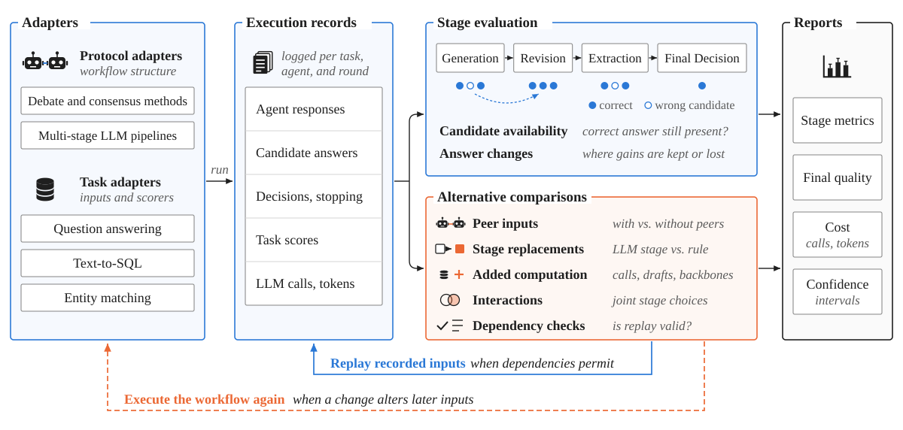
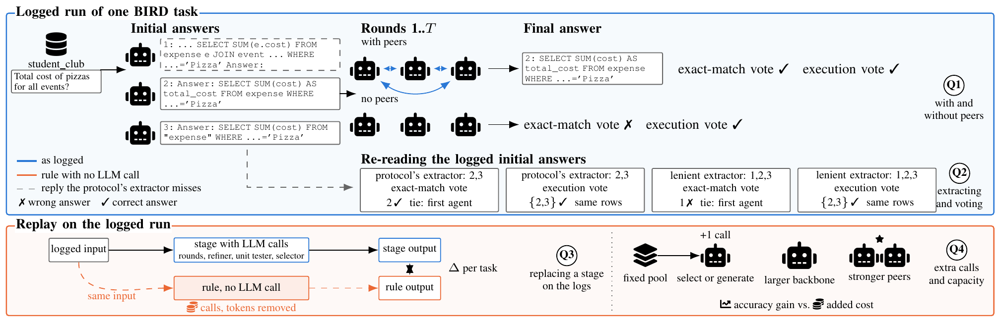

# SHARE-Eval: A Stage-Level Benchmarking Framework for Multi-Agent Debate and Consensus in Data Workflows

Reproducibility repository of the ICDE 2027 Experiment, Analysis, and Benchmark paper *SHARE-Eval: A Stage-Level Benchmarking Framework for Multi-Agent Debate and Consensus in Data Workflows*.

$\color{red}{\textbf{The supplement is}}$ [**paper/supplementary.pdf**](paper/supplementary.pdf)

SHARE-Eval benchmarks multi-agent debate and consensus workflows stage by stage. It compares alternatives
for a stage on the same inputs, measures their quality effects and their calls and tokens, and estimates
peer interaction effects under fixed extraction and voting rules. For each stage it measures how often the output
changes and whether the change improves accuracy; dependency checks establish when a comparison on
recorded inputs reproduces deployment. The paper evaluates five consensus protocols and three published
pipelines on question answering, text-to-SQL and entity matching.

## Benchmarking suite

<p align="center">
  
</p>

*Collection and evaluation workflow. Recorded-run comparisons use dependency checks to determine when replay can reproduce workflow execution.*

The logged runs are processed by the scripts in `share_eval/`, which write the scored tables the paper
objects read (`share_eval/README.md`). `share_eval_suite/` is a refactor of `share_eval/` for reuse by
others: it follows this figure module by module, so that another workflow, task or stage alternative is
added at the matching module and evaluated with the shared records, estimators and reports. Its modules
are `adapters/` (protocol and task adapters), `records/` (the execution record and its readers), `stages/`
(candidate availability, answer changes, grouping after entity matching), `comparisons/` (peer inputs,
stage replacements, added computation, interactions, dependency checks), `reports/` (stage metrics, final
quality, cost, confidence intervals) and `steps/`, which runs each `share_eval/` analysis on the logged runs.
Its results are the same as those of `share_eval/`: the consistency tests run every `share_eval/` script
and the suite step of the same name on the same inputs and compare their output files byte for byte, apart
from timestamps and run times; other tests reproduce the paper's numbers from the scored tables
(`python3 -m share_eval_suite check`; `share_eval_suite/README.md`, "Same results as `share_eval/`").

## SHARE-Eval at a glance



*SHARE-Eval on one BIRD task: the logged run and its re-readings (top); a stage replaced on the logs (bottom).*

- **Logged run, with and without peers (Q1):** the protocol adapters and collection drivers in
  `code/consensus_delivery/` and `experiments/02_controlled_sharing/code/` log every call; the no-peer
  runs for Du-MAD and BCCS come from `experiments/14_nopeer_collection/`.
- **Where quality is lost (Q2):** `share_eval/replay/` re-reads each run under the protocol's extractor
  or the lenient extractor and under the exact-match vote or the execution vote, and follows correct
  candidates from the initial answers to the final answer; the answer-only peer runs come from
  `experiments/16_answer_only_peers/`.
- **Replacing a stage on the logs (Q3):** `share_eval/stage_replacement/` compares a stage with a rule
  that makes no LLM call on the same input, and charges the stage's calls and tokens; the pipelines'
  runs are in `experiments/10_chess_unit_tester/` and `experiments/11_macsql_comem_stages/`.
- **When a replay equals deployment (Lemma 1):** `share_eval/replay_validity/`.
- **Extra calls and capacity (Q4):** selection and generation on a fixed pool
  (`experiments/04_sql_selection_generation/`, `experiments/12_deepseek_selection_generation/`), larger
  backbones and other model families (`experiments/13_backbone_scale_cross_family/`,
  `experiments/08_cross_family/`), stronger peers (`experiments/15_stronger_peers/`), and debates
  against independent drafts at matched call budgets (`experiments/17_budget_matched_debates/`).

## What this repository reproduces

Every table, figure and printed number of the paper and its supplement that comes from a measurement.
Each is computed from scored per-question, per-run or per-pair tables by a short script and checked
against the number printed in the paper:

- 29 paper objects in `paper_objects/`, one directory per table, figure or group of prose numbers;
- 3,143 printed values and 101 statements (an interval excludes 0 or not, a count is zero), each
  matched to the sentence or table cell that prints it.

`PAPER_MAP.md` maps every table and figure label of the paper and the supplement to its directory.

## Running the check

```
python3 verify.py --recompute
```

This reruns every paper object's computation from its `inputs/`, compares each result with the shipped
`output/values.json`, and checks each printed value recorded in `object.json` (about one minute). Without
`--recompute` it compares the shipped outputs only. The last line reads
`N of N checks passed; 3143 of 3143 printed values reproduce`; `--json FILE` writes every check to
FILE. No step calls a language model, starts an inference server, opens a database or needs a GPU.

One object at a time:

```
cd paper_objects/<dir> && python3 code/compute.py --out output
python3 paper_objects/check_objects.py --recompute --only <dir>
```

`REPRODUCE.md` lists every object with the paper objects it covers and its runtime.

## Layout

| Path | Contents |
|---|---|
| `paper/supplementary.pdf` | the supplement |
| `paper_objects/<dir>/` | `inputs/` (scored tables), `code/compute.py` (writes `values.json`), `code/plot.py` (figures only, draws the paper's figure from `output/`), `output/` (expected output), `object.json` (every printed value checked: where the paper prints it, printed form, output key), `README.md` (inputs, estimator, interval method, scope) |
| `paper_objects/check_objects.py` | compares computed values with the printed ones |
| `verify.py` | runs all objects and the repository checks |
| `share_eval/` | the SHARE-Eval scripts for logged runs: re-reading and replay of logged debates (`replay/`), the Lemma 1 checks (`replay_validity/`), and stage replacement with calls and tokens (`stage_replacement/`); `share_eval/README.md` names the intermediate files each step writes and the paper objects that read them |
| `share_eval_suite/` | refactor of `share_eval/` as a Python package organised like the suite figure: adapters, execution records, stage evaluation, alternative comparisons, reports, and the `share_eval/` steps on the logged runs (`steps/`); tests check that its outputs equal those of `share_eval/` and reproduce the paper's numbers (`share_eval_suite/README.md`) |
| `code/consensus_delivery/` | protocol adapters for Du-MAD, MAD-M², BCCS, MoA and FORD, the OpenAI-compatible client, answer extraction and scorers (`code/README.md`) |
| `experiments/<NN_name>/` | collection and run code per experiment, each with a README naming the paper objects it feeds: 02 controlled sharing, 04 SQL selection and generation, 05 matching groups, 06 cost accounting, 07 and 08 peer content and model families, 09 grouping rules, 10 CHESS Unit Tester, 11 MAC-SQL Refiner and ComEM selector, 12 DeepSeek-V4-Pro selection and generation, 13 larger and cross-family backbones, 14 no-peer runs of Du-MAD and BCCS, 15 stronger peers, 16 answer-only peers (Du-MAD and MAD-M² on the 198 BIRD questions with full peer responses, extracted queries only, or no peers), 17 debate budgets and independent drafts (Du-MAD and MAD-M² at 3×2, 3×3, 5×2 and 3×4 agents × rounds, 20 independent initial drafts per question); `common/` holds modules they share |
| `docs/` | the suite figure and the overview figure |
| `data/external/` | checksums of the BIRD and Spider databases |

## Requirements

Python 3.12 or newer with `numpy`, `pandas` and `scipy` (`requirements.txt`); the figure scripts also
need `matplotlib`, and the tests of `share_eval_suite/` need `pytest`. The values were computed with CPython 3.14.5, numpy 2.4.6, pandas 3.0.3 and scipy
1.17.1. Every bootstrap seeds its own generator, so a recomputation returns the same `values.json`.

```
python3 -m venv .venv && . .venv/bin/activate && pip install -r requirements.txt
```

## Reading the numbers

- Terms are those of the paper: initial answers, last-round accuracy, the interaction effect (the
  accuracy change from the initial answers to the last round with peers, minus the same change without
  peers), placebo peers, the answer extractor, the exact-match vote and the execution vote.
- Effects are paired differences in percentage points (pp). For the BIRD debates an effect is detected
  when both question-level and database-cluster 95% intervals exclude 0. Holm corrections apply within
  the families the paper states.
- QA accuracy, SQL execution accuracy, candidate-pair F1 and pairwise cluster F1 are reported separately
  and never pooled.
- The no-peer condition removes the peer replies and the clauses that refer to them from every prompt
  and keeps rounds, stopping and return rules; `experiments/02_controlled_sharing/code/arm_transform.py`
  builds these prompts.

## Data not in this repository

The paper objects start from the scored tables in their `inputs/`, which were derived once from the
logged model outputs. The logged outputs are hosted separately:

| Material | Size | Contents |
|---|---|---|
| Logged runs of the controlled sharing study | 5.1 GB | every call's prompt and reply for the five protocols on QA, entity matching and BIRD/Spider, with and without peers, and their manifests |
| Entity-matching runs | 0.7 GB | pair judgments and traces on WDC Products, Geographic Settlements and the matching protocol study |
| QA selection and trajectory runs | 1.2 GB | QA replies, selections and per-round trajectories |
| Benchmark inputs as run | 520 MB | BIRD and Spider question files with reference queries; matching populations, WDC and Settlements judgments |
| SQL candidate pools | 123 MB | BIRD and Spider candidate queries with execution times |
| Experiment outputs and intermediate analysis tables | about 1.3 GB | per-experiment outputs and analyses from which the `inputs/` tables were derived, including the cross-family and content-choice raw replies |
| Task samples | 1.7 MB | the QA task samples of the controlled sharing study |
| Run records of experiments 16 and 17 | about 1.4 GB | answer-only peer debates (4,752 runs), budget-matched debates and independent drafts (6,336 runs, 23,760 drafts), and their cached SQL execution verdicts |
| Run records of experiments 10–15 and the SHARE-Eval replay inputs | about 11 GB | CHESS, MAC-SQL and ComEM stage runs; DeepSeek-V4-Pro selection and generation; larger and cross-family backbone debates; the no-peer runs of Du-MAD and BCCS; stronger-peer runs; cached SQL execution verdicts |
| Upstream protocol implementations | 69 MB | clones of the released protocol code; repositories and commits in `code/README.md` |

These records are hosted in a Google Drive folder:
https://drive.google.com/drive/folders/1unYMLkW-ONfz4TxE7Ps4S5RmUWREajHI?usp=sharing .
The folder holds one `.tar.gz` archive per group of experiments (large ones split into parts) and a
`SHA256SUMS` file; each archive extracts at the repository root, so its files land where the code reads
them: logged runs under `data/records/<experiment>/`, intermediate tables under `data/derived/<name>/`,
and each experiment's raw calls and outputs under `experiments/<NN_name>/{raw,data,output}/`.

Two sources are not part of the hosted data:

- **GPQA question text.** The GPQA authors ask that its questions not be redistributed publicly in plain
  text. The hosted records contain no GPQA question or option text; the GPQA units' ids, labels and
  outcomes are in the scored tables of this repository (`paper_objects/tab_family-sharing`,
  `text_peer-source`, `text_qa-vote-replay`, `text_matching-content`, `fig_access-matrix`). GPQA is
  available from its official release (`Idavidrein/gpqa`); each unit's `dataset_id` names its source row.
- **MusicBrainz 20K.** It is distributed by the Leipzig benchmark collection; download it from the source
  page the paper cites, https://dbs.uni-leipzig.de/research/projects/benchmark-datasets-for-entity-resolution .
  The grouping results on it are in the scored tables of `paper_objects/text_grouping-rules`,
  `fig_merge-validation` and `tab_sensitivity-census`.

The BIRD and Spider databases are third-party corpora distributed by their authors
(`https://bird-bench.github.io/`, `https://yale-lily.github.io/spider`). No paper-object computation
needs them: SQL outcomes are part of the scored inputs. `data/external/CHECKSUMS.json` records a SHA-256
for every database file used.

## Licensing

The code is released under the MIT License (`LICENSE`). The data in this repository and in the linked
Google Drive folder, and the documentation, are released under the Creative Commons Attribution 4.0
International License (CC BY 4.0, https://creativecommons.org/licenses/by/4.0/; `LICENSE-DATA`).
Third-party benchmark content and upstream code keep their original licences; `LICENSING.md` lists them.
